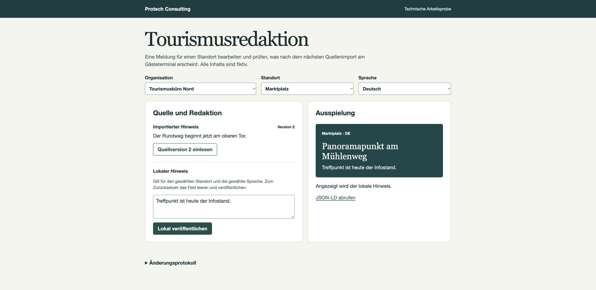

# Tourismusredaktion

Eine ausführbare Arbeitsprobe von Protech Consulting für touristische Redaktions- und Ausspielsysteme. Ein zentraler Datensatz wird für drei Standorte in zwei Organisationen übernommen. Eine Redaktion kann einen einzelnen Beschreibungstext pro Organisation, Standort und Sprache überschreiben. Kiosk und Daten-API zeigen, welche Fassung bei Gästen ankommt.



## Starten

Voraussetzung ist Node.js 20 oder neuer. Die Anwendung verwendet ausschließlich die Standardbibliothek. Im Verzeichnis der heruntergeladenen oder geklonten Dateien ausführen:

```sh
node server.mjs
```

[Lokale Redaktion öffnen](http://127.0.0.1:4173). Die Anwendung läuft auf dem eigenen Rechner. Ein Neustart setzt die fiktiven Beispieldaten zurück. Für einen anderen Port die Umgebungsvariable `PORT` setzen.

## Vorführung in zwei Minuten

1. **Ausgangsdaten** · Nord, Marktplatz und Deutsch auswählen. Die Quelle und die Terminalvorschau zeigen das untere Tor als Startpunkt.
2. **Redaktion** · „Treffpunkt ist heute der Infostand“ in das lokale Hinweisfeld eintragen und veröffentlichen. Vorschau und JSON-LD enthalten den redaktionellen Hinweis.
3. **Reimport** · Quellversion 2 einlesen. Die Quelle nennt jetzt das obere Tor. Der Marktplatz behält den deutschen lokalen Hinweis. Am Bahnhof, im Tal und in der niederländischen Sprachfassung gilt der neue Quelltext.
4. **Wiederholung** · Version 2 erneut einlesen. Das Protokoll bleibt unverändert. Ein leeres Hinweisfeld veröffentlichen, um am Marktplatz zur aktuellen Quellfassung zurückzukehren.

## Schnittstelle und Datenherkunft

```text
GET /api/v1/poi/panoramapunkt?tenant=nord&station=markt&lang=de
```

Die Ausspielung liefert JSON-LD mit stabiler Objekt-ID, sprachabhängigem Namen und Beschreibung. Der Quellbegriff aus einem fiktiven SKOS-Vokabular wird über eine explizite Zuordnung auf Schema.org `TouristAttraction` abgebildet. Die Ausgabe enthält Quellversion, Quellbegriff und Herkunft der Beschreibung. Die Vorschau verwendet ein natives Web Component und denselben HTTP-Leseweg wie ein externer Verbraucher.

Der Import prüft die Zuordnung, alle drei Sprachfassungen, Versionskonflikte und Wiederholungen vor dem Schreiben. Feldkorrekturen bleiben getrennt von der Quelle. Die deutsch-, niederländisch- und englischsprachigen Inhalte, Standorte und Quellen sind Beispiele. Es wird keine externe Datenquelle verändert.

## Prüfung

```sh
node --test test.mjs
```

Die Tests prüfen Feldpriorität, Trennung der Organisationen, Standorte und Sprachen, Rückkehr zur Quelle, idempotenten Import, veraltete und widersprüchliche Versionen, ungültige Datensätze und die JSON-LD-Ausgabe über HTTP.

## Einordnung

Eigenständige technische Arbeitsprobe, November 2026. Datenhaltung und Protokoll liegen für die Laufzeit im Arbeitsspeicher. Die Ortsauswahl simuliert redaktionelle Kontexte. Benutzeranmeldung, Berechtigungsprüfung nach Nutzeridentität, Produktivbetrieb, Live-Anbindungen an tourismusfachliche Datenhubs und ein KI-Modell liegen außerhalb dieses Beispiels. Es handelt sich um eine Eigenentwicklung ohne Auftraggeber oder Kundenabnahme.
